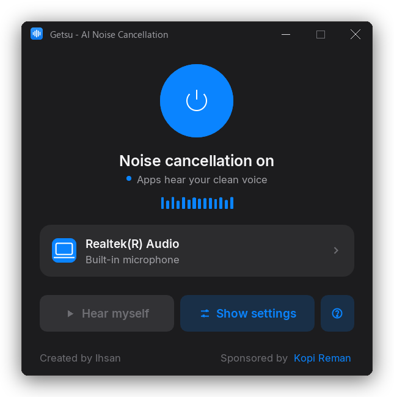

# Getsu

<p align="center">
  
</p>

<p align="center">
  <strong>Clean voice for every app. Free, offline, light on your CPU.</strong><br>
  Getsu removes keyboard clicks, fan hum, room noise and background voices from your microphone, for Discord, Steam, Zoom, games and OBS at once.
</p>

<p align="center">
  <a href="https://github.com/skttr87/getsu/releases/latest"></a>
  <a href="LICENSE"></a>
  
  
</p>

> [!NOTE]
> **Getsu** comes from two Acehnese words: **gèt** (*"good"*) and **su** (*"sound"*).

## What Getsu does

Getsu sits between your microphone and your apps. It removes keyboard and mouse clicks, fan roar, air conditioning, desk bumps and voices in the next room, so the people you talk to hear mostly you.

It works for every app at once: Discord, Steam, Zoom, Google Meet, OBS and games. No per-app plugin is needed.

## Quick start

1. **Install.** [](https://github.com/skttr87/getsu/releases/latest)  
   Download and run the [latest Getsu setup installer](https://github.com/skttr87/getsu/releases/latest). The installer sets up the free VB-CABLE virtual audio cable in the background.
2. **Pick your microphone.** Open Getsu from the Desktop or Start Menu and choose your microphone in the microphone card.
3. **Click the power button.** Getsu starts cleaning your voice. Apps set to the **Default** microphone use the clean voice automatically. Click the button again to stop.

To hear how you sound, click **Hear Myself (11s Voice Test)** while Getsu is stopped. Speak for 11 seconds and Getsu plays back your cleaned voice.

## New in v1.4.0

- A new interface.
- **Start with Windows:** tick it in the tray menu. Getsu then starts hidden in the tray at sign-in, turns noise cancellation back on if it was on when you closed it, and waits up to 20 seconds for USB or Bluetooth microphones that appear late. Untick it to turn it off. Uninstalling removes the startup entry.
- More microphones work, including microphone names in other languages and headset microphones that run at 16 kHz (issues #1 and #3).
- The noise filter runs about 5 times faster.
- Getsu switches to a USB or wired headset when you plug it in.
- Windows can no longer leave the virtual cable as your default microphone or speakers.
- Better handling of Bluetooth headsets. The virtual cable is set to 48 kHz, and a too-low microphone level is fixed once when you turn noise cancellation on.
- Tray menu: **Check for updates** (opens the GitHub releases page) and **Save diagnostics**.

## Performance

Measured on a Ryzen 7 5800H laptop:

| Measure | Result |
|---|---|
| Processing time | about 0.2 ms for every 10 ms of audio |
| CPU while cleaning your voice | about 2 % of one CPU core |
| CPU with the window open and idle | about 2 % |
| CPU while hidden in the tray | under 1 % |
| GPU | not used |

<!-- measured at release: total delay (latency) and installer size, to be filled in by the maintainer before publishing -->

Results on other PCs will differ.

## Troubleshooting

### An app still hears background noise

Getsu sends clean audio to apps set to the **Default** microphone. An app that was locked to your physical microphone needs a change:

* **Steam:** Settings > Voice > set **Voice Input Device** to `Default` (or `CABLE Output (VB-Audio Virtual Cable)`). Turn off Steam's own Noise Cancellation to avoid double processing.
* **Discord:** User Settings > Voice & Video > set **Input Device** to `Default` (or `CABLE Output (VB-Audio Virtual Cable)`). Turn off Discord's Krisp noise suppression.
* **Games (CS2, Valorant, Apex, Call of Duty):** in the in-game audio or voice settings, use `Default System Device` or `CABLE Output`.
* Turn off the app's own voice activation threshold.

### Bluetooth earbuds sound bad

When a Bluetooth headset uses its microphone, Windows switches it to call quality (mono, narrow band). That comes from Bluetooth, not from Getsu. A separate microphone keeps game audio in full quality.

### Reporting a problem

1. Right-click the Getsu icon in the tray and choose **Save diagnostics**.
2. Attach the file it saves to a [GitHub issue](https://github.com/skttr87/getsu/issues). The file holds the log and the device list. It does not contain audio.
3. Optional: run `getsu-cli --probe-mic` in a Command Prompt and paste the output into the issue. It tries several ways to open the microphone and reports which works. It changes no settings.

### Windows SmartScreen says "Unknown publisher"

Getsu is open-source software and is not signed with a paid code-signing certificate. Click **More info**, then **Run anyway**. The SHA-256 checksum of each installer is listed on the [releases page](https://github.com/skttr87/getsu/releases).

## Privacy

* Getsu makes no network connections. A test in the source code checks this.
* **Check for updates** only opens the GitHub releases page in your browser.
* Audio never leaves your PC and is never saved to disk.
* No account or login is needed. The full source code is in this repository.

## How Getsu compares

Krisp and NVIDIA Broadcast are different products. Check each vendor for current prices and requirements.

| | **Getsu** | Krisp | NVIDIA Broadcast |
|---|---|---|---|
| Price model | Free, open source | Subscription, with a free tier | Free |
| Hardware | Any PC, no GPU needed | Any PC | NVIDIA RTX graphics card |
| Works in | Every app that uses the microphone | Any app that uses its virtual microphone | Any app that uses its virtual microphone |

## Command line: getsu-cli

`getsu-cli.exe` cleans audio files from a terminal or a script. It runs on its own, so it works while the Getsu window is open. If you chose "Add Getsu CLI to system PATH" during installation, you can run it from any folder.

```powershell
# Clean one file (writes recording_cleaned.wav)
getsu-cli --clean recording.wav

# Clean one file to a chosen path
getsu-cli --clean recording.wav D:\audio\cleaned.wav

# Clean every WAV, MP3, FLAC and OGG file in a folder
getsu-cli --clean D:\recordings\podcast\

# Linked-stereo gating for stereo and multi-channel files
getsu-cli --clean interview_stereo.wav --stereo

# Music and singing: skips the neural model, keeps room decay and vibrato
getsu-cli --clean vocal_take.wav --music-mode

# Makeup gain, or normalise quiet speech toward -24 dBFS
getsu-cli --clean quiet_mic.wav --gain 4.0
getsu-cli --clean quiet_mic.wav --auto-level
```

| Option | Description |
|---|---|
| `--clean <path>` | File or folder to clean (required). |
| `[output_path]` | Output WAV file or folder (optional, defaults to `<name>_cleaned.wav`). |
| `--stereo` | Linked-stereo gating for stereo and multi-channel files. |
| `--music-mode` | Skips RNNoise and uses an 800 ms sustain with a 250 ms decay, for music and singing. |
| `--auto-level` | Raises quiet speech toward -24 dBFS. |
| `--gain <dB>` | Makeup gain in decibels (for example `--gain 3.0`). |
| `--no-rnnoise` | Turns off RNNoise (rumble filter and noise gate only). |
| `--no-gate` | Turns off the noise gate (RNNoise only). |
| `--report-json <file>` | Writes a frame-by-frame JSON log. |
| `--no-progress` | Hides the progress bar, useful in scripts. |
| `--no-stats` | Hides the summary table. |
| `--check-devices` | Prints the audio devices and a diagnostics report. |
| `--probe-mic` | Tries to open a microphone several ways and reports which works. Changes no settings. |

## Limits

* **Windows only:** Windows 10 and Windows 11 (64-bit). There is no macOS or Linux build.
* **Virtual audio cable:** Getsu uses VB-CABLE to pass clean audio to other apps. The official installer sets it up for you.
* **Unsigned installer:** see the SmartScreen answer in Troubleshooting.

## Credits and license

* **[RNNoise](https://github.com/xiph/rnnoise)** by Jean-Marc Valin (Xiph.Org, Mozilla): the neural network that suppresses noise. Built from source for Getsu, with CPU-specific speed-ups.
* **[SpeexDSP](https://github.com/xiph/speexdsp)** by Jean-Marc Valin and contributors (Xiph.Org), BSD-3-Clause ([license](licenses/SpeexDSP-COPYING)).
* **[DearPyGui](https://github.com/hoffstadt/DearPyGui)**: the GUI engine.
* **[Inter](https://rsms.me/inter/)** by Rasmus Andersson, SIL Open Font License 1.1 ([license](docs/assets/fonts/OFL.txt)): the interface font.
* **[VB-CABLE](https://www.vb-cable.com)** by VB-Audio (Vincent Burel): the virtual audio cable that carries your clean voice to other apps. The Getsu installer includes the official, unmodified VB-CABLE package. VB-CABLE is donationware, all participations are welcome: if you find it useful, please support VB-Audio at [www.vb-cable.com](https://www.vb-cable.com).

Sponsored by [Kopi Reman](https://www.instagram.com/kopireman/).

This project is open source under the [MIT License](LICENSE).

---

<details>
<summary><strong>For developers</strong></summary>

### Audio processing path

```
Microphone > 80 Hz rumble filter > RNNoise (CPU) > noise gate > CABLE Output
```

### Building from source

```powershell
# 1. Clone the repository
git clone https://github.com/skttr87/getsu.git
cd getsu

# 2. Set up a virtual environment
python -m venv venv
.\venv\Scripts\activate
pip install -r requirements.txt

# 3. Run the app or the tests
python -m src.main
python -m unittest discover tests
```

### Building the standalone executable

```powershell
python -m PyInstaller --clean --noconfirm build/getsu.spec
```

</details>
